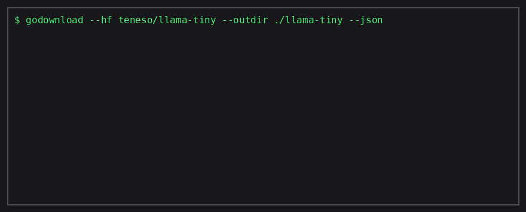

# godownload

[](https://github.com/saromanov/godownload/actions/workflows/ci.yml)
[](https://pkg.go.dev/github.com/saromanov/godownload)
[](https://goreportcard.com/report/github.com/saromanov/godownload)
[](https://github.com/saromanov/godownload/releases)

A Go download manager for agents and humans: resumable and multi-segment downloads,
checksum verification, mirrors, rate limiting, HuggingFace model fetching —
as a library and a single-binary CLI with a JSON report for tool-calls.



## Why godownload

| Feature | godownload | aria2c | wget | curl |
|---------|-----------|--------|------|------|
| Resume on failure (`.part`) | ✓ | ✓ (`-c`) | ✓ (`-c`) | ✓ (`-C -`) |
| Checksum before the file is visible | ✓ (md5/sha1/sha256/sha512) | ✓ (`--checksum`) | — | — |
| Parallel ranged segments | ✓ | ✓ | — | — |
| Rate limiting | ✓ | ✓ | ✓ | ✓ |
| Declarative manifest with mirrors | ✓ (YAML) | ✓ (Metalink) | — | — |
| ETag freshness check (no re-download) | ✓ (`--no-stale`) | — | — | — |
| Bulk HuggingFace model fetch | ✓ (`--hf`) | — | — | — |
| Machine-readable JSON report | ✓ (`--json`) | — | — | — |
| Library API (Go) | ✓ | RPC only | — | — |
| Static single binary, zero deps | ✓ | — | ✓ | — |
| Atomic writes | ✓ | — | — | — |

Download results and per-download callbacks (`OnDone`, `OnProgress`) are available
to library users (see [Download results](#download-results)).

## Agent workflow

Download a model and get a stable JSON report back — for agent tool-calls
and scripts:

```bash
godownload --hf teneso/llama-tiny --outdir ./llama-tiny --json
# repeat runs transfer nothing until the repository changes on the server
```

## Install

```
go get github.com/saromanov/godownload
go install github.com/saromanov/godownload/cmd/godownload@latest
```

## Usage

Download a file (the name is taken from the URL):

```go
package main

import godownload "github.com/saromanov/godownload"

func main() {
    gd := godownload.GoDownload{}
    if err := gd.Download("http://arxiv.org/pdf/1206.5538v3.pdf", nil); err != nil {
        panic(err)
    }
}
```

With a specific output file:

```go
gd := godownload.GoDownload{}
err := gd.Download("http://arxiv.org/pdf/1206.5538v3.pdf", &godownload.Options{Outpath: "fun.pdf"})
```

Download multiple files in parallel:

```go
gd := godownload.GoDownload{}
err := gd.DownloadMany([]*godownload.Options{
    {URL: "https://example.com/a.pdf", Outpath: "a.pdf"},
    {URL: "https://example.com/b.pdf", Outpath: "b.pdf"},
})
```

Download by links listed in a file:

```go
gd := godownload.GoDownload{}
err := gd.FromFile("links.txt")
```

Download an HTML page:

```go
gd := godownload.GoDownload{}
err := gd.Download("https://example.com", &godownload.Options{Page: true, Outpath: "index.html"})
```

Custom timeout and retries:

```go
gd := godownload.GoDownload{Timeout: 30 * time.Second}
err := gd.Download("https://example.com/file.zip", &godownload.Options{Retry: 3})
```

## API

### GoDownload

Global settings (all optional):

| Field | Description |
|-------|-------------|
| `Overwrite` | Overwrite a file with the same name |
| `Alwaysnew` | Always create a new file (`file_1`, `file_2`, ...) |
| `UserAgent` | User-Agent for HTTP requests |
| `Retry` | Number of retry attempts on network errors and 5xx responses |
| `Auth` | Basic authentication in the `username:password` format |
| `Archive` | Archive format for the downloaded file (`zip`) |
| `Configpath` | Path to a YAML config |
| `Outdir` | Directory for downloaded files |
| `Timeout` | HTTP request timeout (no timeout by default) |
| `Logger` | Custom logger (`nil` — standard `log`) |
| `Quiet` | Disable all logging output |
| `HTTPClient` | Custom `http.Client` |
| `OnProgress` | Progress callback (see below) |
| `Checksum` | Checksum verification (see below) |
| `RateLimit` | Download speed cap in bytes per second |
| `Segments` | Number of parallel ranged segments |
| `NoStale` | Skip the download when the file is up to date (see below) |

### Options

Per-download settings (the same fields where applicable) plus:

| Field | Description |
|-------|-------------|
| `URL` | URL — needed only for `DownloadMany` |
| `Page` | Download an HTML page instead of a file |
| `Outpath` | Path of the downloaded file |

All methods return `error`. Sentinel errors: `ErrFileExists`, `ErrChecksumMismatch`, `ErrUnsupportedArchive`.

### Download results

Every download method has a `*Result` variant that reports the outcome:
`DownloadResult`, `DownloadManyResult`, `DownloadManySimpleResult`,
`FromFileResult`, `FromManifestResult` — all take `context.Context`
and return `Result{URL, Path, Size, Bytes, Segments, ChecksumVerified, Duration}`.
Alternatively, `GoDownload.OnDone` (or `Options.OnDone`) is called once
per successfully downloaded file:

```go
gd := godownload.GoDownload{}
res, err := gd.DownloadResult(ctx, "https://example.com/model.bin",
    &godownload.Options{Checksum: "sha256:...", Segments: 8})
if err != nil {
    return err
}
fmt.Printf("saved to %s (%d bytes, %d segments, verified: %v, took %s)\n",
    res.Path, res.Size, res.Segments, res.ChecksumVerified, res.Duration)
```

`DownloadManyResult` returns the results of successful downloads together
with an aggregated error on partial failure.

> **v2.0:** methods no longer terminate the process via `log.Fatal`/`panic` and return `error` instead. This is a breaking change compared to v1.

## Reliability features

Atomic writes, resume and checksum verification are always on for file downloads
(`Options.Checksum` is opt-in):

- The file lands under its final name only after a successful write (atomic rename from `file.part`)
- Interrupted downloads resume via `Range` requests (`file.part` is kept on failure)
- `ErrFileExists`, `ErrChecksumMismatch`, `ErrUnsupportedArchive` are checkable with `errors.Is`

Progress, throttling and multi-segment downloads:

```go
gd := godownload.GoDownload{Timeout: 30 * time.Second}
err := gd.Download("https://example.com/big.iso", &godownload.Options{
    Outpath:   "big.iso",
    Segments:  8,                // parallel ranged segments
    RateLimit: 10 * 1024 * 1024, // 10 MiB/s
    Checksum:  "sha256:...",     // verify before the file becomes visible
    OnProgress: func(transferred, total int64) {
        fmt.Printf("\r%d / %d", transferred, total)
    },
})
```

Declarative downloads from a YAML manifest with mirrors:

```yaml
- url: https://example.com/model.bin
  out: model.bin
  checksum: sha256:b5bb9d80...
  segments: 8
  mirrors:
    - https://mirror.example.com/model.bin
- url: https://example.com/data.csv
  out: data.csv
  retry: 5
```

```go
gd := godownload.GoDownload{}
if err := gd.FromManifest("downloads.yaml"); err != nil {
    // ...
}
```

## Freshness check (NoStale)

With `NoStale: true` the download is skipped when the server reports the file
unchanged since the last download of the same output file. After each download
the validator headers (`ETag`, `Last-Modified`) are stored in a sidecar file
`<outpath>.gd-meta`; the next download sends a conditional request
(`If-None-Match` / `If-Modified-Since`) and keeps the existing file on a `304 Not Modified`:

```go
gd := godownload.GoDownload{}
res, err := gd.DownloadResult(ctx, "https://example.com/model.bin",
    &godownload.Options{Outpath: "model.bin", NoStale: true})
if err != nil {
    return err
}
if res.CacheHit {
    fmt.Println("already up to date:", res.Path)
}
```

An existing output file is not rejected with `ErrFileExists` when `NoStale` is
set: the freshness check decides whether it is re-downloaded. Works with
multi-segment downloads (the probe request is conditional) and with the CLI
`--no-stale` flag.

## Downloading HuggingFace models

`DownloadHF` fetches a full model repository (all files, nested paths preserved):

```go
gd := godownload.GoDownload{}
results, err := gd.DownloadHFResult(ctx, "meta-llama/Llama-3.2-1B",
    &godownload.Options{Outpath: "llama-3.2-1b", Segments: 8, NoStale: true})
if err != nil {
    return err
}
for _, r := range results {
    fmt.Printf("%s: %d bytes\n", r.Path, r.Size)
}
```

- Files are resolved through `https://huggingface.co/<repo>/resolve/main/...`
  (LFS redirects to the CDN are followed automatically)
- Every file keeps its repository path under `Options.Outpath`
- `Segments`, `RateLimit`, `Retry`, `NoStale` and other options apply per file;
  `NoStale` makes repeated runs transfer nothing when the repository is unchanged
- `Options.HFAPIURL` points the client to a self-hosted HuggingFace-compatible
  endpoint (or a test server)

## Context support

Every download method has a context-aware variant (`DownloadContext`,
`DownloadManyContext`, `DownloadManySimpleContext`, `FromFileContext`,
`FromManifestContext`). Context cancellation aborts in-flight HTTP requests.

## CLI

The repository ships a CLI built on top of the library (see the [release workflow](.github/workflows/release.yml) for binaries):

```
godownload [flags] URL...
godownload --manifest downloads.yaml
godownload --from-file links.txt --segments 8 --checksum sha256:...
godownload --hf owner/model --outdir ./models --json
```

The `--json` flag prints a machine-readable report for agents and scripts —
one object per download (`url`, `path`, `size`, `bytes`, `segments`,
`checksum_verified`, `cache_hit`, `duration_ns`) plus an `error` field on failure:

```
$ godownload --hf meta-llama/Llama-3.2-1B --outdir ./models --json
{
  "downloads": [
    {
      "url": "https://huggingface.co/meta-llama/Llama-3.2-1B/resolve/main/config.json",
      "path": "models/config.json",
      "size": 861,
      "bytes": 861,
      "segments": 1,
      "checksum_verified": false,
      "cache_hit": false,
      "duration_ns": 45231500
    }
  ]
}
```

## Contributing

See [CONTRIBUTING.md](CONTRIBUTING.md). Security issues: [SECURITY.md](SECURITY.md).
